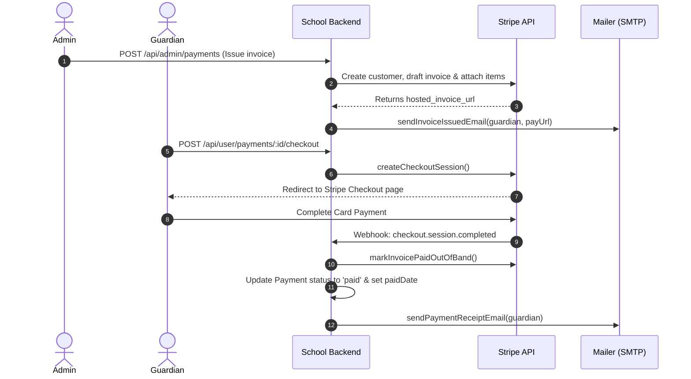

# School Management System

A comprehensive school management backend API built with Node.js, Express, and MongoDB, featuring multi-role access (Admin, Teacher, Student, Guardian), Stripe payment integration, automated email notifications via Nodemailer/SMTP, comprehensive Gradebook management, section-based attendance tracking, and media management via Cloudinary.

---

## Features

### Core & Cross-Cutting
- **Role-Based Access Control (RBAC)** - Tailored middleware and permissions for Admin, Teacher, Student, and Guardian roles with active-account verification.
- **Secure Authentication** - JWT-based authentication with bcrypt password hashing and secure token validation.
- **Stripe Payment Engine** - Invoicing, Stripe Checkout sessions, out-of-band payment settlement, live on-demand Stripe sync, and automated webhook synchronization.
- **Email Notification System** - Multi-transport email dispatcher (Nodemailer SMTP & Mailtrap fallback) with responsive HTML templates for credentials, invoices, and receipts.
- **Media & Document Storage** - Multer and Cloudinary v2 integration with multi-file uploads (images, PDFs, documents, spreadsheets) and automatic deletion upon entity removal.
- **Dynamic Access Control** - Specialized scope and access helpers for gradebooks, exams, attendance, materials, and homework.

### Admin Features
- **Admin Dashboard** - Real-time statistics, pending invoice counts, "under review" complaint metrics, and population analytics.
- **Gradebook Publishing** - Review class gradebooks, inspect assessments and student score maps, update evaluations, and toggle published status to students and guardians.
- **Student Management** - Registration with multi-file ID documents, guardian linkage, class assignments, status toggles, and cascade deletion.
- **Teacher Management** - Faculty onboarding with automated credentials delivery, subject and class associations, and cascade deletion.
- **Guardian Management** - Account tracking, multi-student linkage, profile photo updates, and cascade deletion.
- **Payment & Invoice Management** - Issue fees/invoices with Stripe sync, resend invoice emails with direct payment links, cancel invoices, and track balances.
- **Class & Course Management** - Create and manage classes and courses with cover images, teacher assignments, and bidirectional relationship unlinking on deletion.
- **Complaint Management & Audit Trail** - Full status transition lifecycle (`pending` ➔ `under_review` ➔ `resolved`) with resolution notes and append-only `statusHistory` logging.
- **Announcement Management** - Publish campus-wide announcements with attachments and cascade Cloudinary cleanup on deletion.

### Teacher Features
- **Gradebook & Assessment System** - Create custom assessments (quizzes, class tests, mid-terms, final terms, assignments), input/update student scores, and write teacher remarks.
- **Section-Based Attendance** - Record daily section attendance via optimized MongoDB `bulkWrite` upserts, and inspect monthly calendar attendance matrices.
- **Materials & Lessons** - Publish course materials and study resources with multi-file attachments, flexible scheduling, and file cleanup on deletion.
- **Homework Management** - Assign tasks with course links, instructions, attachments, max scores, and submission due dates.
- **Exam & Result Management** - Schedule examinations and record student scores and grading in bulk.
- **Teacher Announcements** - Author and manage faculty/class announcements with attachment uploads.
- **Faculty Directory** - View assigned courses, classes, enrolled student rosters, and linked guardian contact information.

### User Portal (Student & Guardian)
- **Gradebook & Academic Performance** - View published class grades with automated percentage calculation and standardized letter grades (A+, A, B, C, D, F).
- **Announcements Feed** - Browse announcements filtered by role targeting (`students`, `guardians`, or `all`).
- **Materials & Homework** - Access class materials, download study documents, and view pending homework deadlines.
- **Attendance History** - Track personal attendance rates and daily records; guardians can review individual attendance metrics across multiple wards.
- **Payment Portal & Stripe Checkout** - View outstanding invoices, launch Stripe Checkout sessions, confirm payments, and trigger on-demand live sync with Stripe.
- **Unified Dashboard** - Aggregated summary of class details, upcoming exams, homework deadlines, and attendance metrics.

---

## Getting Started

### Prerequisites
- **Node.js** (v18+)
- **MongoDB** instance (local or Atlas)
- **Cloudinary** account (for media & document storage)
- **Stripe** account (for invoices, checkout & webhooks)
- **SMTP Provider / Mailtrap** account (for transactional emails)

### Installation
```bash
git clone https://github.com/FarhadNuri/School-Management.git
cd School-Management
npm install
```

### Environment Variables
Create a `.env` file in the root directory:
```env
PORT=5000
NODE_ENV=development

# Database
MONGO_URI=your_mongodb_connection_string

# Authentication
JWT_SECRET=your_jwt_secret_key
JWT_EXPIRES_IN=7d

# Application URLs
FRONTEND_URL=http://localhost:5173
ADMIN_URL=http://localhost:5174

# Cloudinary
CLOUDINARY_CLOUD_NAME=your_cloudinary_name
CLOUDINARY_API_KEY=your_cloudinary_api_key
CLOUDINARY_API_SECRET=your_cloudinary_api_secret

# Transactional Email (SMTP / Nodemailer)
EMAIL_SERVICE=gmail
EMAIL_USER=your_email@gmail.com
EMAIL_PASS=your_email_app_password
EMAIL_FROM_NAME="School Management System"

# Mailtrap Fallback (Optional)
MAILTRAP_TOKEN=your_mailtrap_api_token
MAILTRAP_FROM_EMAIL=your_verified_sender@domain.com
MAILTRAP_FROM_NAME="School Web App"

# Stripe Payments
STRIPE_API_KEY=your_stripe_secret_key
STRIPE_PUBLISHABLE_KEY=your_stripe_publishable_key
STRIPE_WEBHOOK_SECRET=your_stripe_webhook_signing_secret
```

### Running Locally
```bash
# Start development server with hot reloading
npm run dev
```

---

## Project Structure

```
src/
├── config/
│   ├── cloudinary.js       # Cloudinary v2 configuration
│   ├── env.js              # Environment variable loader
│   ├── seedAdmin.js        # Default admin initializer
│   └── stripe.js           # Stripe SDK client initialization
├── controllers/
│   ├── admin/              # Admin domain controllers
│   │   ├── admin.controller.js
│   │   ├── announcement.controller.js
│   │   ├── class.controller.js
│   │   ├── complaint.controller.js
│   │   ├── course.controller.js
│   │   ├── dashboard.controller.js
│   │   ├── gradebook.controller.js
│   │   ├── guardian.controller.js
│   │   ├── payment.controller.js
│   │   ├── student.controller.js
│   │   └── teacher.controller.js
│   ├── teacher/            # Teacher domain controllers
│   │   ├── announcement.controller.js
│   │   ├── attendance.controller.js
│   │   ├── exam.controller.js
│   │   ├── gradebook.controller.js
│   │   ├── homework.controller.js
│   │   ├── lesson.controller.js
│   │   └── teacher.controller.js
│   ├── user/               # Student & Guardian domain controllers
│   │   ├── announcement.controller.js
│   │   ├── attendance.controller.js
│   │   ├── dashboard.controller.js
│   │   ├── exam.controller.js
│   │   ├── grade.controller.js
│   │   ├── homework.controller.js
│   │   ├── lesson.controller.js
│   │   ├── payment.controller.js
│   │   ├── student.controller.js
│   │   └── user.controller.js
│   └── user.controller.js  # Base user profile & auth
├── middleware/
│   ├── admin.middleware.js   # Admin JWT & RBAC guard
│   ├── teacher.middleware.js # Teacher JWT & active status guard
│   ├── user.middleware.js    # Student/Guardian authentication guard
│   └── multer.middleware.js  # Multi-type upload parser (documents, IDs, avatars)
├── models/
│   ├── admin.model.js
│   ├── announcement.model.js
│   ├── assignment.model.js
│   ├── attendance.model.js
│   ├── class.model.js
│   ├── complaint.model.js
│   ├── course.model.js
│   ├── event.model.js
│   ├── exam.model.js
│   ├── gradebook.model.js
│   ├── guardian.model.js
│   ├── homework.model.js
│   ├── lesson.model.js
│   ├── notification.model.js
│   ├── payment.model.js
│   ├── quiz.model.js
│   ├── resource.model.js
│   ├── student.model.js
│   ├── teacher.model.js
│   └── user.model.js
├── routes/
│   ├── admin.route.js       # /api/admin
│   ├── teacher.route.js     # /api/teacher
│   └── user.route.js        # /api/user
├── services/
│   └── stripe.service.js    # Stripe invoices, checkout & sync operations
├── utils/
│   ├── attendanceAccess.js  # Attendance metrics calculation
│   ├── emailTemplate.js     # Responsive HTML email templates
│   ├── examAccess.js        # Exam scoping, roster filtering & stats
│   ├── generatePassword.js  # Secure random password generator
│   ├── homeworkAccess.js    # Homework submission & scope validation
│   ├── idTypes.js           # Identification type validation & rules
│   ├── lessonAccess.js      # Lesson authorization & scope filtering
│   ├── Mailer.js            # Nodemailer SMTP transport service
│   ├── payment.helpers.js   # Fee labels, serialization, and population
│   ├── paymentEmails.js     # Payment receipt & invoice email dispatcher
│   └── userHelpers.js       # Address normalization, search & data sanitation
├── webhooks/
│   ├── index.js             # Webhook route definitions
│   └── stripe.webhook.js    # Stripe event signature validation & handlers
└── index.js                 # Application bootstrap & database connection
```

---

## API Routes Overview

### Admin Routes (`/api/admin`)
| Method | Endpoint | Description |
| :--- | :--- | :--- |
| **POST** | `/login` | Admin authentication |
| **GET** | `/me` | Current admin profile |
| **PATCH** | `/change-password` | Update admin password |
| **PATCH** | `/update-photo` | Update profile picture |
| **GET** | `/dashboard` | System statistics and analytics |
| **GET** / **POST** | `/grades` | List class gradebooks or inspect evaluations |
| **GET** / **PUT** | `/grades/:id` | View or update gradebook assessments & scores |
| **PATCH** | `/grades/:id/publish` | Toggle gradebook published status |
| **POST** / **GET** | `/announcements` | Create or list announcements |
| **DELETE** | `/announcements/:id` | Delete announcement with attachment cleanup |
| **POST** / **GET** | `/classes` | Create or list classes with cover images |
| **DELETE** | `/classes/:id` | Delete class and unlink teachers, courses, students |
| **POST** / **GET** | `/courses` | Create or list courses with teacher links |
| **DELETE** | `/courses/:id` | Delete course and unlink from classes |
| **GET** | `/complaints` | Review student & teacher complaints |
| **PATCH** | `/complaints/:id/status` | Update complaint status (`pending`/`under_review`/`resolved`) with audit trail |
| **DELETE** | `/complaints/:id` | Delete complaint and clean up attachments |
| **POST** / **GET** | `/students` | Register student or browse roster |
| **PATCH** | `/students/:id` | Update student profile and ID documents |
| **PATCH** | `/students/:id/status` | Toggle student active status |
| **DELETE** | `/students/:id` | Delete student and unlink from guardian/class |
| **GET** | `/guardians` | List parent/guardian accounts |
| **PATCH** | `/guardians/:id` | Update guardian details |
| **PATCH** | `/guardians/:id/status` | Toggle guardian active status |
| **DELETE** | `/guardians/:id` | Delete guardian and unlink students |
| **POST** / **GET** | `/teachers` | Onboard teacher or list faculty |
| **PATCH** | `/teachers/:id` | Update teacher profile and qualifications |
| **PATCH** | `/teachers/:id/status` | Toggle teacher active status |
| **DELETE** | `/teachers/:id` | Delete teacher and unlink from classes/courses |
| **POST** / **GET** | `/payments` | Issue invoices or list all school fees |
| **POST** | `/payments/:id/resend` | Resend invoice notification email with pay link |
| **POST** | `/payments/:id/cancel` | Void invoice in Stripe and locally |

### Teacher Routes (`/api/teacher`)
| Method | Endpoint | Description |
| :--- | :--- | :--- |
| **GET** | `/classes` | List teacher's assigned classes |
| **GET** | `/courses` | List teacher's assigned courses/subjects |
| **GET** | `/guardians` | View guardians of students in teacher's classes |
| **GET** | `/grades` | List gradebooks for assigned classes |
| **GET** / **PUT** | `/grades/:classId` | Retrieve or save class gradebook scores |
| **GET** / **POST** | `/materials` | List or upload learning materials and resources |
| **PATCH** / **DELETE**| `/materials/:id` | Update or delete study materials |
| **GET** / **POST** | `/lessons` | List or create lessons |
| **PATCH** / **DELETE**| `/lessons/:id` | Update or delete lessons |
| **GET** / **POST** | `/homeworks` | List or assign homework tasks |
| **GET** / **POST** | `/exams` | List or schedule exams |
| **PUT** | `/exams/:id/results` | Submit or update exam grades & marks |
| **GET** | `/attendance/sections` | List assigned class sections for daily attendance |
| **GET** | `/attendance/sections/:classId/monthly` | Get monthly section attendance summary |
| **GET** / **PUT** | `/attendance/sections/:classId/date/:date` | Get or record daily section attendance |
| **GET** / **PUT** | `/attendance/lessons/:lessonId` | Legacy lesson-based attendance tracking |
| **GET** / **POST** | `/announcements` | List or publish teacher announcements |
| **PATCH** / **DELETE**| `/announcements/:id` | Update or delete teacher announcements |

### User Routes (`/api/user` - Students & Guardians)
| Method | Endpoint | Description |
| :--- | :--- | :--- |
| **GET** | `/dashboard` | User dashboard overview |
| **GET** | `/grades` | View published grades, percentages, and letter grades |
| **GET** | `/announcements` | View published announcements filtered by audience |
| **GET** | `/materials` | Browse uploaded class materials |
| **GET** | `/lessons` | View accessible class lessons |
| **GET** | `/homeworks` | View assigned homework tasks |
| **GET** | `/exams` | View exam schedules and scores |
| **GET** | `/students` | View profile or linked wards (guardians) |
| **GET** | `/attendance` | View student attendance record |
| **GET** | `/attendance/summary` | Aggregate attendance percentage & metrics |
| **GET** | `/attendance/wards` | View children attendance records (guardians) |
| **GET** | `/payments` | View fee history and pending balances |
| **GET** | `/payments/:id` | Retrieve single invoice details |
| **POST** | `/payments/:id/checkout` | Create Stripe Checkout session for payment |
| **GET** | `/payments/checkout-session/:id` | Confirm completed Stripe Checkout session |
| **POST** | `/payments/:id/sync` | Manually sync live invoice status with Stripe |

### Webhook Routes (`/api/webhooks`)
| Method | Endpoint | Description |
| :--- | :--- | :--- |
| **POST** | `/stripe` | Verifies Stripe signature and processes `checkout.session.completed` and `invoice.paid` |

---

## Email & Payment Lifecycles

### Automated Transactional Emails
All transactional emails are delivered via **Nodemailer SMTP** (with Mailtrap fallback) using responsive HTML templates:
1. **Credentials Email**: Automatically triggered on Student, Teacher, or Guardian creation with temporary credentials.
2. **Invoice Issued Email**: Dispatched when an admin creates an invoice, including student details, due date, and direct Stripe payment link.
3. **Payment Receipt Email**: Automatically generated upon Stripe checkout completion, webhook confirmation, or offline payment recording.

### Stripe Integration Workflow


---

## Contributing

1. Create a feature branch (`git checkout -b feature/feature-name`)
2. Commit your changes with conventional commit messages (`git commit -m "feat(...): ..."`)
3. Push to the branch (`git push origin feature/feature-name`)
4. Create a Pull Request with a clear summary of modifications

---

## License

This project is licensed under the MIT License.
