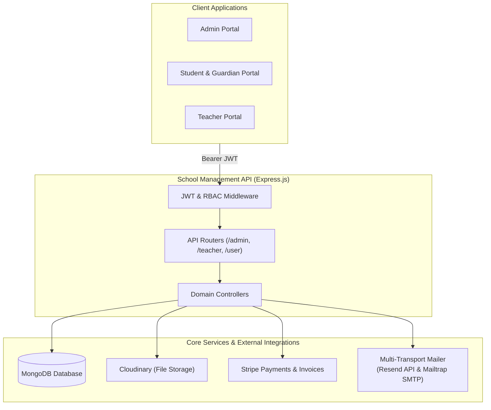
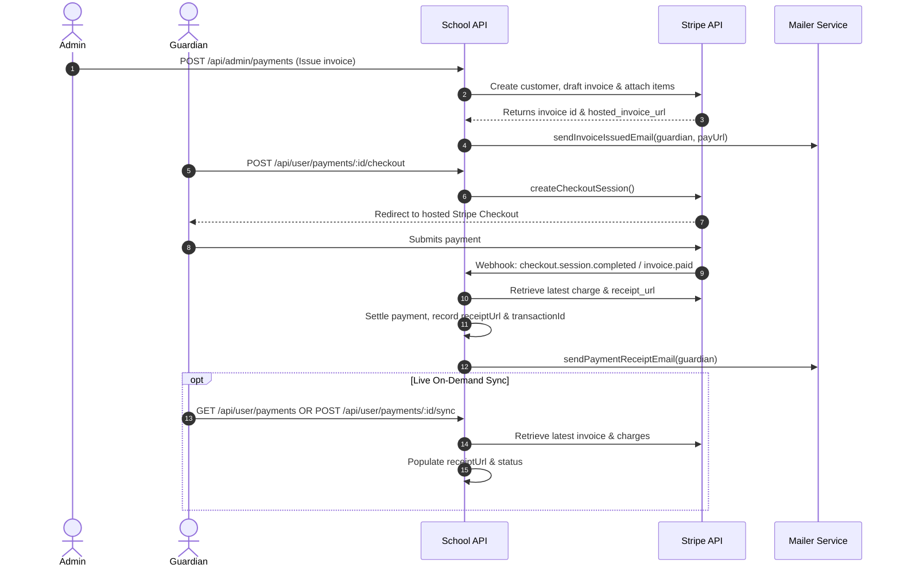

# Sunrise Model School - Backend Server

A comprehensive, enterprise-ready School Management Backend API built with **Node.js**, **Express**, and **MongoDB**. Designed for multi-tenant educational institutions, it provides granular role-based access control (Admin, Teacher, Student, Guardian), Stripe-powered automated billing with live receipt synchronization, class & teacher timetable routines, homework submission lifecycles, subject-scoped gradebooks, daily section attendance, and media management powered by Cloudinary.

---

## Key Features

### Core & Cross-Cutting Architecture
- **Role-Based Access Control (RBAC)** - Strict JWT middleware and active-status guards tailored for Admin, Teacher, Student, and Guardian roles.
- **Resilient Multi-Transport Email Engine** - High-priority delivery via **Resend HTTPS API** (bypassing outbound SMTP port blocking on cloud hosts like Render), with automatic fallback to **Brevo API**, **Mailtrap API**, and **Nodemailer SMTP** (equipped with 5-second socket timeout guards).
- **Stripe Billing & Invoicing Engine** - Full billing lifecycle with Stripe Checkout sessions, hosted invoice URLs, automated webhook processing, out-of-band payment settlement, live on-demand Stripe sync, and official Stripe receipt retrieval.
- **Academic Timetable & Routine System** - Comprehensive scheduling engine mapping classes, subjects, teachers, periods, time slots, and classrooms.
- **Homework Submission Engine** - Complete student submission workflow with document/image uploads, late submission detection, resubmissions, teacher grading, and remarks.
- **Subject-Scoped Gradebooks** - Gradebooks isolated by class and subject with tamper-resistant publication locks to preserve academic integrity.
- **Media & Document Storage** - Cloudinary v2 multi-file upload parser (supporting images, PDF documents, and spreadsheets) with automated file purging upon record deletion or photo updates.


---

### Admin Features
- **Executive Dashboard** - Real-time statistics, pending invoice counts, student/teacher/guardian population metrics, and complaint resolution analytics.
- **Routine & Schedule Management** - Full CRUD control over school routines and timetables (days of week, period slots, assigned courses, teachers, and classrooms).
- **Class & Course Management** - Manage classes and courses with cover images and teacher links; multiple classes can seamlessly share common curriculum courses.
- **Gradebook Review & Publishing** - Review class gradebooks by subject, inspect assessments and marks, update evaluations, and toggle published status for student and guardian visibility.
- **Student Onboarding & Management** - Register students with multi-file ID documents, guardian linkages, and class assignments. Auto-generates secure credentials returned in the API response and delivered via email. One-click password reset endpoint.
- **Teacher Onboarding & Management** - Faculty onboarding with automated credential generation, subject assignments, profile management, and password resets.
- **Guardian Management** - Account tracking, multi-student linkage, profile photo updates, and password resets.
- **Invoicing & Fees** - Issue fees with automated Stripe customer and invoice creation, resend invoices with direct Stripe pay links, void/cancel invoices, and track payment receipts.
- **Complaint Resolution & Audit Trail** - End-to-end complaint tracking (`pending` ➔ `under_review` ➔ `resolved`) with resolution notes and append-only status history.
- **Announcements** - Publish campus-wide announcements targeted to specific roles with attachments and cascade deletion.


---

### Teacher Features
- **Subject-Scoped Gradebooks** - Record and update assessment scores (quizzes, class tests, mid-terms, final exams, assignments) scoped to assigned subjects without overwriting other teachers' records. Published gradebooks are locked against unintended changes.
- **Homework Lifecycle Management** - Assign tasks with course links, instructions, attachments, max scores, and submission due dates. Delete homework with automatic Cloudinary file cleanup.
- **Homework Submissions Review** - Inspect student submissions, download submitted student work, view late submission flags, and assign grades and feedback.
- **Section-Based Daily Attendance** - Mark and update daily attendance via optimized MongoDB `bulkWrite` upserts, or inspect monthly attendance matrices by section.
- **Materials & Lessons** - Publish syllabus resources, study materials, and lesson plans with multi-file uploads and scheduled visibility.
- **Examinations & Grading** - Schedule exams and record student marks in bulk.
- **Teacher Announcements** - Author and manage class-targeted announcements with attachments.
- **Assigned Rosters & Timetable** - View assigned classes, subject codes, enrolled student rosters, and guardian emergency contact details.

---

### User Portal (Students & Guardians)
- **Homework Submissions & Tracking** - View assigned homework, upload submission documents or external links, add student notes, track late submission flags, and inspect graded marks and teacher feedback.
- **Class Timetable / Routine** - Access weekly class routines and schedules; guardians can inspect individual routines for any of their linked children.
- **Profile Photo Self-Service** - Upload and update personal profile avatars via Cloudinary with automatic deletion of legacy photos.
- **Course & Lesson Directory** - Browse enrolled courses, view detailed course profiles with teacher contact info, and download lesson resources.
- **Academic Performance & Gradebook** - View published grades with automated percentage calculation, assessment breakdowns, and standardized letter grades (A+, A, B, C, D, F).
- **Payment Portal & Stripe Receipts** - Browse outstanding and paid invoices, launch Stripe Checkout sessions, confirm payments, download invoice PDFs, and access official hosted Stripe payment receipts.
- **Attendance Records** - Review personal attendance percentages; guardians can monitor attendance metrics across each of their linked children.
- **Complaint Submission** - Submit inquiries or complaints with attachments and track status transitions in real time.

---

## System Architecture



---

## Getting Started

### Prerequisites
- **Node.js** (v18.0.0 or higher)
- **MongoDB** (local replica set or MongoDB Atlas)
- **Cloudinary** account (for media and document uploads)
- **Stripe** account (for payments, checkout sessions, and invoices)
- **Resend** / **Brevo** / **Mailtrap** or **SMTP** credentials (for transactional emails)

### Installation
```bash
# Clone the repository
git clone https://github.com/FarhadNuri/School-Management.git
cd School-Management

# Install dependencies
npm install
```

### Environment Configuration
Create a `.env` file in the root directory:

```env
# Application & Server
PORT=5000
NODE_ENV=development

# Database
MONGO_URI=mongodb+srv://<username>:<password>@cluster0.mongodb.net/school_management?retryWrites=true&w=majority

# Authentication
JWT_SECRET=your_jwt_super_secret_key
JWT_EXPIRES_IN=7d

# Allowed Frontend URLs (CORS)
FRONTEND_URL=http://localhost:5173
ADMIN_URL=http://localhost:5174

# Cloudinary Storage
CLOUDINARY_CLOUD_NAME=your_cloudinary_cloud_name
CLOUDINARY_API_KEY=your_cloudinary_api_key
CLOUDINARY_API_SECRET=your_cloudinary_api_secret

# Primary Cloud Email API (Port 443 - Recommended for Cloud Deployments like Render)
RESEND_API_KEY=re_your_resend_api_key
RESEND_FROM=onboarding@resend.dev

# Fallback Cloud Email APIs (Optional)
BREVO_API_KEY=your_brevo_api_key
MAILTRAP_TOKEN=your_mailtrap_api_token

# Fallback SMTP Email (Gmail / Mailtrap SMTP)
EMAIL_SERVICE=gmail
EMAIL_USER=your_email@gmail.com
EMAIL_PASS=your_google_app_password
EMAIL_FROM_NAME="School Management System"

MAILTRAP_HOST=sandbox.smtp.mailtrap.io
MAILTRAP_PORT=2525
MAILTRAP_USERNAME=your_mailtrap_username
MAILTRAP_PASSWORD=your_mailtrap_password

# Stripe Payments & Invoices
STRIPE_API_KEY=sk_test_your_stripe_secret_key
STRIPE_PUBLISHABLE_KEY=pk_test_your_stripe_publishable_key
STRIPE_WEBHOOK_SECRET=whsec_your_stripe_webhook_signing_secret
```

### Available Scripts
```bash
# Start in development mode with nodemon hot-reloading
npm run dev

# Start in production mode
npm start
```

---

## Project Structure

```
src/
├── config/
│   ├── cloudinary.js            # Cloudinary v2 SDK configuration
│   ├── database.js              # MongoDB Mongoose connection handler
│   ├── env.js                   # Environment variable validation & loader
│   ├── seedAmin.js              # Default root admin seeder
│   └── stripe.js                # Stripe SDK client initialization
├── controllers/
│   ├── admin/                   # Admin domain controllers
│   │   ├── admin.controller.js
│   │   ├── announcement.controller.js
│   │   ├── class.controller.js
│   │   ├── complaint.controller.js
│   │   ├── course.controller.js
│   │   ├── dashboard.controller.js
│   │   ├── gradebook.controller.js
│   │   ├── guardian.controller.js
│   │   ├── payment.controller.js
│   │   ├── routine.controller.js   # Timetable CRUD
│   │   ├── student.controller.js
│   │   └── teacher.controller.js
│   ├── teacher/                 # Teacher domain controllers
│   │   ├── announcement.controller.js
│   │   ├── attendance.controller.js
│   │   ├── exam.controller.js
│   │   ├── gradebook.controller.js
│   │   ├── homework.controller.js
│   │   ├── lesson.controller.js
│   │   └── teacher.controller.js
│   ├── user/                    # Student & Guardian domain controllers
│   │   ├── announcement.controller.js
│   │   ├── attendance.controller.js
│   │   ├── dashboard.controller.js
│   │   ├── exam.controller.js
│   │   ├── grade.controller.js
│   │   ├── homework.controller.js   # Submissions & status
│   │   ├── lesson.controller.js     # Courses & materials
│   │   ├── payment.controller.js    # Checkout & sync
│   │   ├── routine.controller.js    # Weekly schedule lookup
│   │   ├── student.controller.js
│   │   └── user.controller.js       # Complaints
│   └── user.controller.js       # User auth, profile, and photo updates
├── middleware/
│   ├── admin.middleware.js        # Admin JWT & RBAC guard
│   ├── error.middleware.js        # Global 404 & centralized error handler
│   ├── multer.middleware.js       # Multi-file Cloudinary storage parser
│   ├── teacher.middleware.js      # Teacher JWT & active status guard
│   └── user.middleware.js         # Student/Guardian authentication guard
├── models/
│   ├── address.model.js           # Subdocument schema for addresses
│   ├── admin.model.js             # Admin profile schema
│   ├── announcement.model.js      # Campus & class announcements
│   ├── assignment.model.js        # Class assignments
│   ├── attendance.model.js        # Daily section attendance records
│   ├── class.model.js             # Academic class schema
│   ├── complaint.model.js         # Complaints & audit trail
│   ├── course.model.js            # Course/Subject schema
│   ├── event.model.js             # School events
│   ├── exam.model.js              # Examinations & results
│   ├── gradebook.model.js         # Subject-scoped gradebook evaluations
│   ├── guardian.model.js          # Guardian profile schema
│   ├── homework.model.js          # Homework tasks schema
│   ├── homeworkSubmission.model.js# Student homework submissions
│   ├── lesson.model.js            # Lesson materials schema
│   ├── payment.model.js           # Payments, invoices & Stripe metadata
│   ├── quiz.model.js              # Quizzes schema
│   ├── resource.model.js          # Study resources
│   ├── routine.model.js           # Class & teacher schedule slots
│   ├── student.model.js           # Student profile schema
│   ├── teacher.model.js           # Teacher profile schema
│   └── user.model.js              # Base user credentials & roles
├── routes/
│   ├── admin.route.js             # /api/admin
│   ├── teacher.route.js           # /api/teacher
│   └── user.route.js              # /api/user
├── services/
│   └── stripe.service.js          # Stripe invoices, checkout, sync & receipts
├── utils/
│   ├── attendanceAccess.js        # Attendance calculations
│   ├── emailTemplate.js           # Responsive HTML transactional email templates
│   ├── examAccess.js              # Exam scoping and statistics
│   ├── generatePassword.js        # Secure temporary password generator
│   ├── homeworkAccess.js          # Homework access & validation
│   ├── idTypes.js                 # Identification document validation
│   ├── lessonAccess.js            # Course & lesson scoping
│   ├── Mailer.js                  # Multi-transport email dispatcher
│   ├── payment.helpers.js         # Payment serialization & fee labels
│   ├── paymentEmails.js           # Receipt & invoice email triggers
│   └── userHelpers.js             # Sanitization and normalization
├── webhooks/
│   ├── index.js                   # Webhook route mount with raw body parser
│   └── stripe.webhook.js          # Stripe signature verification & event handling
└── index.js                       # Server entry point & database connection
```

---

## API Reference

### System & Health (`/api`)
| Method | Endpoint | Access | Description |
| :--- | :--- | :--- | :--- |
| **GET** | `/api/health` | Public | Server health status, uptime, and timestamp |

---

### Admin Routes (`/api/admin`)
| Method | Endpoint | Description |
| :--- | :--- | :--- |
| **POST** | `/login` | Admin authentication |
| **POST** | `/test-email` | Diagnostic endpoint to test outbound email delivery |
| **GET** | `/me` | Current admin profile |
| **PATCH** | `/me/password` | Update admin password |
| **PATCH** | `/me/photo` | Update admin profile photo (Cloudinary) |
| **GET** | `/dashboard` | System analytics and summary metrics |
| **POST** / **GET** | `/routines` | Create routine slot or filter timetable records |
| **GET** / **PUT** / **DELETE** | `/routines/:id` | View, update, or delete routine timetable slot |
| **GET** | `/grades` | List class gradebooks scoped by subject |
| **GET** / **PUT** | `/grades/:id` | Inspect or update gradebook evaluations |
| **PATCH** | `/grades/:id/publish` | Toggle gradebook publication status |
| **POST** / **GET** | `/classes` | Create class (with cover image) or list classes |
| **GET** / **PATCH** / **DELETE**| `/classes/:id` | Inspect, update, or remove class |
| **POST** / **GET** | `/courses` | Create course or list curriculum courses |
| **GET** / **PATCH** / **DELETE**| `/courses/:id` | Inspect, update, or remove course |
| **POST** / **GET** | `/students` | Register student (returns credentials) or list students |
| **GET** / **PATCH** / **DELETE**| `/students/:id` | View, update profile/IDs, or delete student |
| **PATCH** | `/students/:id/status` | Toggle student active status |
| **PATCH** | `/students/:id/reset-password` | Generate new password and send reset email |
| **POST** / **GET** | `/teachers` | Onboard teacher (returns credentials) or list faculty |
| **GET** / **PATCH** / **DELETE**| `/teachers/:id` | View, update profile, or delete teacher |
| **PATCH** | `/teachers/:id/status` | Toggle teacher active status |
| **PATCH** | `/teachers/:id/reset-password` | Generate new password and send reset email |
| **GET** | `/guardians` | List parent/guardian accounts |
| **GET** / **PATCH** / **DELETE**| `/guardians/:id` | View, update, or delete guardian |
| **PATCH** | `/guardians/:id/status` | Toggle guardian active status |
| **PATCH** | `/guardians/:id/reset-password` | Generate new password and send reset email |
| **POST** / **GET** | `/payments` | Issue invoice with Stripe sync or list payments |
| **GET** / **PATCH** | `/payments/:id` | Retrieve or edit payment/invoice record |
| **POST** | `/payments/:id/resend` | Resend invoice email with direct Stripe payment link |
| **POST** | `/payments/:id/cancel` | Void invoice on Stripe and cancel locally |
| **GET** | `/complaints` | Review user complaints across the institution |
| **GET** / **DELETE** | `/complaints/:id` | View complaint or delete with attachments |
| **PATCH** | `/complaints/:id/status` | Update status (`pending`/`under_review`/`resolved`) |
| **POST** / **GET** | `/announcements` | Publish announcement with attachments or list |
| **GET** / **PATCH** / **DELETE**| `/announcements/:id` | Inspect, update, or delete announcement |

---

### Teacher Routes (`/api/teacher`)
| Method | Endpoint | Description |
| :--- | :--- | :--- |
| **GET** | `/classes` | List assigned classes with subject names & course codes |
| **GET** | `/classes/:id` | Inspect specific class details and student roster |
| **GET** | `/courses` | List assigned courses |
| **GET** | `/guardians` | View guardians of enrolled students |
| **GET** | `/guardians/:id` | Inspect guardian contact profile |
| **GET** | `/grades` | List gradebooks for assigned classes & subjects |
| **GET** / **PUT** | `/grades/:classId` | Retrieve or save marks for subject gradebook |
| **GET** / **POST** | `/homeworks` | List assigned homeworks or assign new task |
| **GET** / **PATCH** | `/homeworks/:id` | Retrieve single homework or update instructions/due date |
| **DELETE** | `/homeworks/:id` | Delete homework task with Cloudinary file cleanup |
| **GET** | `/homeworks/:id/submissions` | Inspect all student submissions, files, and late flags |
| **GET** / **POST** | `/materials` | List or upload learning resources (`handleLessonUpload`) |
| **GET** / **PATCH** / **DELETE**| `/materials/:id` | View, update, or delete study materials |
| **GET** / **POST** | `/lessons` | List or create lesson plans |
| **GET** / **PATCH** / **DELETE**| `/lessons/:id` | View, update, or delete lesson plans |
| **GET** / **POST** | `/exams` | List or schedule examinations |
| **GET** / **PATCH** | `/exams/:id` | View or update examination schedule |
| **PUT** | `/exams/:id/results` | Submit or update student examination grades in bulk |
| **GET** | `/attendance/sections` | List assigned class sections for daily attendance |
| **GET** | `/attendance/sections/:classId/monthly` | Retrieve monthly section attendance matrix |
| **GET** / **PUT** | `/attendance/sections/:classId/date/:date` | View or record daily section attendance |
| **GET** / **POST** | `/announcements` | List or publish teacher announcements |
| **PATCH** / **DELETE**| `/announcements/:id` | Update or delete teacher announcement |

---

### User Routes (`/api/user` - Students & Guardians)
| Method | Endpoint | Description |
| :--- | :--- | :--- |
| **POST** | `/login` | Student / Guardian authentication |
| **GET** | `/me` | Current authenticated user profile |
| **PATCH** | `/change-password` | Update current account password |
| **PATCH** | `/me/photo` *(or `/photo`)* | Upload / update profile avatar (Cloudinary) |
| **GET** | `/dashboard` | Aggregated dashboard (deadlines, exams, attendance) |
| **GET** | `/routine` | Get weekly class schedule/timetable (or ward schedule) |
| **GET** | `/courses` | Browse enrolled courses with teacher profiles |
| **GET** | `/courses/:id` | Inspect single course details and schedule |
| **GET** | `/homeworks` | View homeworks with inline submission status & marks |
| **GET** | `/homeworks/:id` | Detailed homework view with student submission details |
| **POST** | `/homeworks/:id/submit` | Submit homework (document/image upload or link) |
| **GET** | `/grades` | View published grades, score percentages & letter grades |
| **GET** | `/materials` *(or `/lessons`)* | Access class lessons, notes, and study files |
| **GET** | `/materials/:id` | Inspect specific material/lesson |
| **GET** | `/exams` | View upcoming examinations and graded results |
| **GET** | `/exams/:id` | View single exam details |
| **GET** | `/attendance` | Personal attendance logs and percentage rate |
| **GET** | `/attendance/summary` | Aggregated attendance percentage metrics |
| **GET** | `/attendance/wards` | Review attendance records for linked children (Guardians) |
| **GET** | `/students` | View student profile or linked children roster |
| **GET** | `/students/:id` | View individual student/ward details |
| **GET** | `/payments` | View fee history, invoice PDFs & Stripe receipts |
| **GET** | `/payments/:id` | View single invoice with live Stripe sync status |
| **POST** | `/payments/:id/checkout` | Create Stripe Checkout session for payment |
| **GET** | `/payments/checkout-session/:sessionId` | Confirm and finalize Stripe Checkout session |
| **POST** | `/payments/:id/sync` | Manually sync live payment & receipt status with Stripe |
| **POST** | `/complaint` | File a new complaint with attachments |
| **GET** | `/complaints` | View personal submitted complaints |
| **GET** / **PATCH** | `/complaint/:id` | View complaint status or add additional comments |
| **GET** | `/announcements` | View announcements targeted to the user's role |
| **GET** | `/announcements/:id` | View single announcement details |

---

### Webhook Routes (`/api/webhooks`)
| Method | Endpoint | Description |
| :--- | :--- | :--- |
| **POST** | `/stripe` | Verifies Stripe signature, settles invoices, fetches receipts, and sends payment confirmations |

---

## Billing Lifecycles


### Stripe Checkout & Receipt Workflow



---

## Contributing

1. Fork the repository
2. Create a feature branch (`git checkout -b feat/my-new-feature`)
3. Commit your changes (`git commit -m "feat(module): add new functionality"`)
4. Push to your branch (`git push origin feat/my-new-feature`)
5. Open a Pull Request detailing the purpose and scope of your modifications

---

## License

This project is licensed under the [ISC License](LICENSE).
